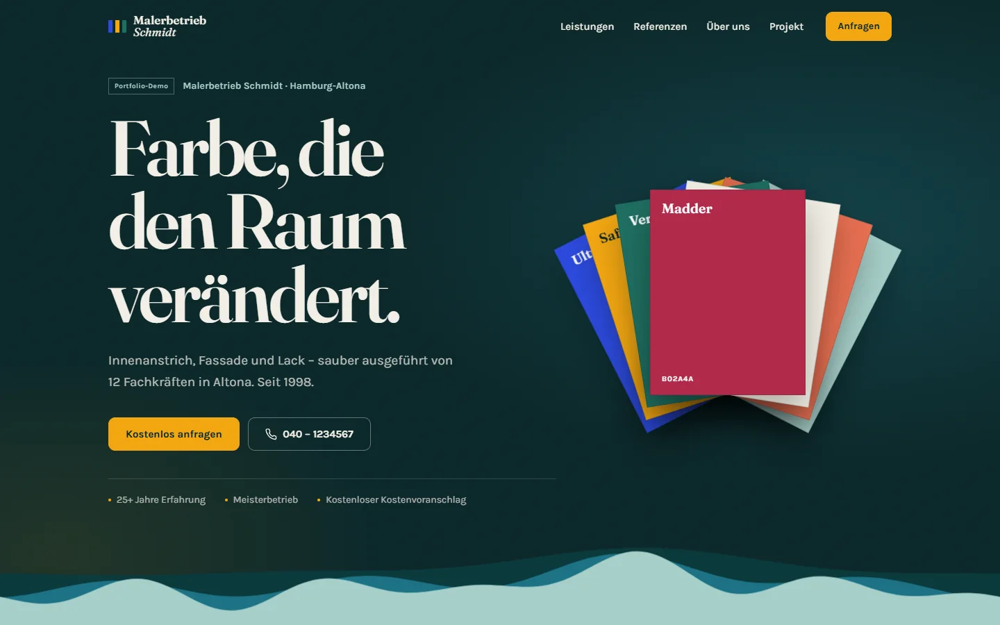
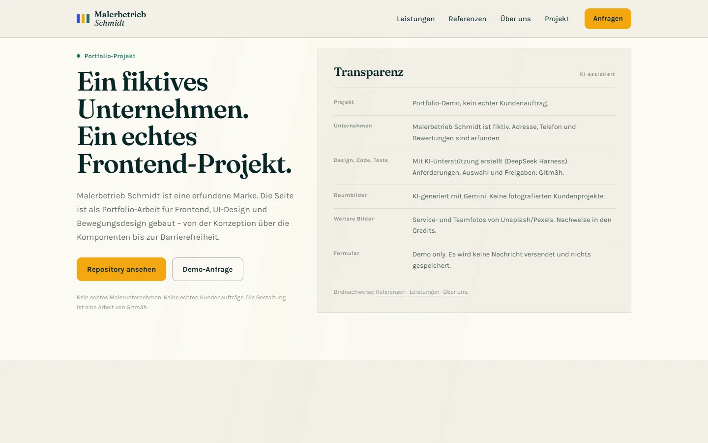

# Malerbetrieb Schmidt — Frontend Portfolio Case Study

A fictional Hamburg painting company, built as a responsive frontend and UI-design portfolio project.

**Live demo:** [my-nuzl291ofg.brewpage.app](https://my-nuzl291ofg.brewpage.app/)  
**Repository:** [github.com/Gitm3h/Malerbetrieb](https://github.com/Gitm3h/Malerbetrieb)  
**Design spec:** [docs/DESIGN-SPEC.md](docs/DESIGN-SPEC.md)



> **AI disclosure.** This is an AI-assisted portfolio project, not client work. I set the requirements, made the design and content decisions, reviewed the output, and approved the final result. Design exploration, code, and copy were produced with **DeepSeek Harness**, an AI coding agent. Room renders were generated with **Gemini**. The Google-style reviews are invented. Service and team photos come from Unsplash/Pexels. Full details are below.

## What this is

Malerbetrieb Schmidt is a **fictional business**. The site demonstrates:

- Art direction for a trade business without the usual stock-photo template look.
- Responsive layouts from 320px to wide desktop.
- A seven-colour, interactive pigment deck in the hero.
- Before/after comparison with pointer, touch, and keyboard control.
- A scrollable review strip with auto-scroll and hover/focus pause.
- A link and scroll “whoosh” transition.
- Accessible form states, focus management, and reduced-motion support.

There are **no real customers, no real projects, no real reviews, and no backend**. The contact form is a demo and does not send or store anything.

## Project context

This project is meant to show frontend craft: responsive composition, interaction design, CSS animation, accessibility, and careful content framing. The business identity is invented so the visual direction can be explored without using a real client’s name or work.

The transparency section is part of the live page at `#projekt`, not hidden in this README.



## Stack

- React 19
- Vite 8
- Tailwind CSS 4
- Plain CSS for the wave, deck, reviews, and whoosh
- Semantic HTML, focus management, reduced-motion support
- No UI framework, no carousel library, no runtime animation dependency

## AI usage

| Area | How it was made |
|---|---|
| Design exploration, code, copy | Produced with DeepSeek Harness under human direction |
| Room before/after images | Generated with Gemini; selected and supplied by Gitm3h |
| Google-style reviews | Written and invented for the demo |
| Awards/badges | Invented; no real awards were given |
| Service and team photos | Unsplash/Pexels, credited in the source tree |
| Requirements, review, approval | Gitm3h |

The AI did not invent a real client, a real project, or real testimonials. The site labels the business as fictional, the reviews as fictional, and the room images as AI illustrations.

## Features

- Responsive hero with a seven-colour fanned pigment deck.
- Deck closes, reorders, and reopens like a magician’s fan; hover draws a card out.
- Accessible before/after slider with keyboard, pointer, and touch support.
- Service cards linked to a preselected enquiry.
- Horizontally scrollable review strip with hidden scrollbar and auto-scroll.
- Fictional awards strip that drifts opposite the reviews, with native horizontal scroll and hover pause.
- Link/scroll speed-streak effect, disabled for reduced motion.
- Mobile navigation sheet with focus trap.
- Impressum/Datenschutz modal with focus trap.
- Client-side validation and a simulated success state.

## Getting started

```bash
npm install
npm run dev
```

Build and check:

```bash
npm run lint
npm run build
npm run preview
```

`vite.config.js` uses `base: './'`, so the build works both at a domain root and under a GitHub Pages project path.

## Deployment

The site is currently published two ways:

- **BrewPage:** static ZIP upload, unlisted.
- **GitHub Pages:** built output on the `gh-pages` branch.

Every push to `main` runs `.github/workflows/publish.yml`:

1. Install with `npm ci`.
2. Build with `npm run build`.
3. Force-push `dist/` to an orphan `gh-pages` branch.
4. Point GitHub Pages at `gh-pages` / root when the workflow token has permission.

The workflow cannot push local changes that were never committed. A change must reach `main` first.

If the Pages source is not set automatically, enable it once in **Settings → Pages → Deploy from a branch → `gh-pages` / root**.

## Credits

- Room pairs: Gemini-generated, supplied by Gitm3h. See [`src/assets/referenzen/CREDITS.md`](src/assets/referenzen/CREDITS.md).
- Service images: Unsplash/Pexels. See [`src/assets/services/CREDITS.md`](src/assets/services/CREDITS.md).
- Painter photo: Pexels. See [`src/assets/about/CREDITS.md`](src/assets/about/CREDITS.md).
- Fonts: Fraunces and Karla via Google Fonts.

## Contact

Portfolio and code: [Gitm3h on GitHub](https://github.com/Gitm3h).

This project is independent portfolio work. It is not affiliated with, endorsed by, or presented as a real painting company.
